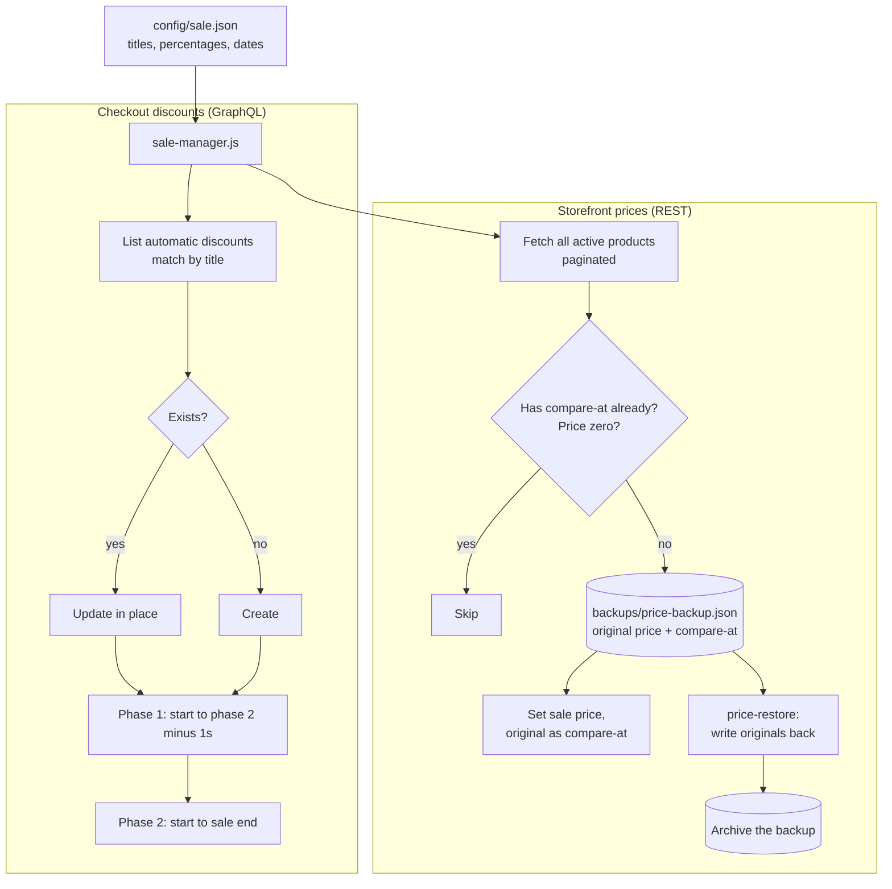

# Shopify Sale Manager: a two-phase site-wide sale run from the command line, with a price backup and one-command restore

A CLI that runs a store-wide sale through the Shopify Admin API. It schedules two back-to-back automatic discounts that hand off to each other without anyone being online, and it can mark every variant down with a strikethrough original price, then put every price back exactly as it was.

## The problem

A site-wide sale with a deeper final phase means several things have to happen at exact times: the first discount starts, it ends at the moment the second begins, and the second ends on schedule. Showing slashed prices on product pages is worse: it means editing the price and compare-at price of every variant in the catalog, and reversing all of it afterward.

Done by hand in the admin, that is hundreds of edits with no record of what the prices were before. A bulk editor does the markdown but leaves the same question at the end of the sale: what was the original price of each variant, and which ones already had a compare-at price of their own?

## What it does

`src/sale-manager.js` is one file with seven commands:

| Command | What happens |
|---|---|
| `status` | Lists every automatic discount on the store with value, dates and state, flags the ones this tool manages, and says whether a price backup exists |
| `set-phase1` | Creates or updates the phase 1 discount, ending one second before phase 2 starts, and schedules phase 2 in the same run |
| `set-phase2` | Schedules phase 2. If its start time has already passed, ends phase 1 and activates phase 2 immediately |
| `price-mark` | Sets every active variant to the phase 1 sale price with the original as the compare-at price, saving each original to a backup file first |
| `price-mark-phase2` | Recalculates every backed-up variant at the phase 2 percentage, from the original price |
| `price-restore` | Puts every variant's price and compare-at price back from the backup, then archives the backup |
| `end` | Deactivates the sale's discounts |

Sale names, percentages and dates live in `config/sale.json`.

## Architecture



## Key design decisions

**The handoff is scheduled, not performed.** Phase 1 is given an end time one second before phase 2's start, and both are created in one run. Shopify's own scheduler makes the switch, so nothing depends on a script or a person running at midnight.

**Discounts are upserted by title.** Each command looks up existing automatic discounts by the configured titles and updates them in place. Running a command twice changes nothing and never leaves a duplicate discount competing with the first.

**The original is saved before the price is touched.** For each variant, the original price and original compare-at price are written to the backup file before the update call. An interrupted run can still be restored.

**Existing markdowns are left alone.** A variant that already has a compare-at price is skipped, so a product that was on sale before the event keeps its own pricing, and a second `price-mark` run only picks up variants the first one missed.

**Phase 2 is calculated from the original, not from the phase 1 price.** The deeper markdown reads the backup, so 20% means 20% off the real price and not 20% off an already reduced one.

**Restore is exact and keeps the evidence.** Restore writes back both fields per variant, including an empty compare-at where there was none. The backup is archived with a timestamp only when every variant restored; if any failed, it stays in place for a rerun.

**Late is handled.** If `set-phase2` runs after the phase 2 start time, it ends phase 1 at the current moment and starts phase 2 immediately instead of scheduling a start in the past.

**Paced for the API.** Variant updates are spaced to stay under the REST rate limit, and product listing follows pagination links.

**Two mechanisms, one choice.** The automatic discount reduces the total at checkout; `price-mark` reduces the listed price itself. They stack if both are active, so a sale uses one or the other: discounts for a checkout-level sale, marked prices for strikethroughs on product pages.

## Repository layout

```
src/sale-manager.js        discount scheduling, price markdown, backup and restore
config/sale.example.json   example two-phase sale definition
```

## Setup

Requires Node 18+ and a Shopify custom app token with `read_discounts`, `write_discounts`, `read_products` and `write_products`. No dependencies to install.

```bash
cp config/sale.example.json config/sale.json   # your titles, percentages and dates
export SHOPIFY_STORE=your-store.myshopify.com
export SHOPIFY_ADMIN_TOKEN=your_admin_api_token
node src/sale-manager.js status                # read-only
node src/sale-manager.js set-phase1
```

| Variable | Purpose |
|---|---|
| `SHOPIFY_STORE` | The store's `myshopify.com` domain |
| `SHOPIFY_ADMIN_TOKEN` | Admin API token |
| `CONFIG_DIR` | Where `sale.json` lives. Default `./config` |
| `BACKUP_DIR` | Where the price backup is kept. Default `./backups` |

Keep the backup file until `price-restore` has finished. Try the price commands on a development store first; they change live prices.

---

Extracted from a production automation suite I built and ran for a live e-commerce and B2B wholesale business, 2026.

© Michael Wootan. Source shared for portfolio review; all rights reserved.
